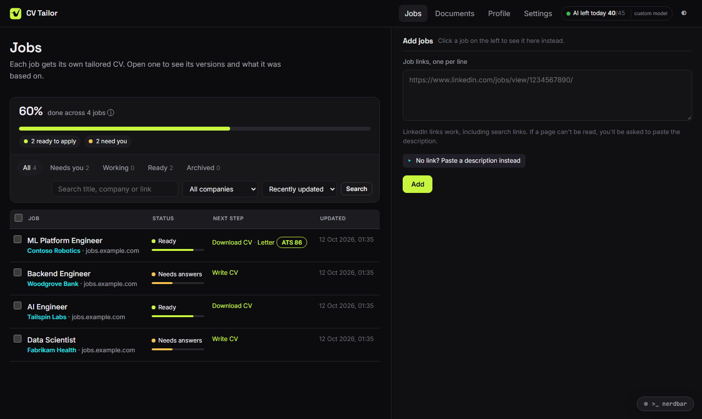
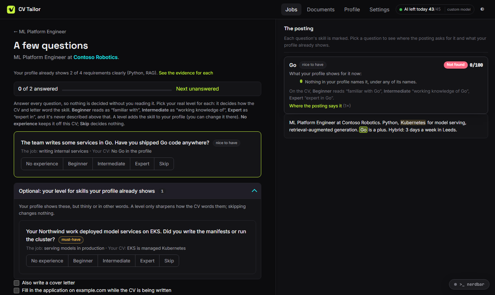
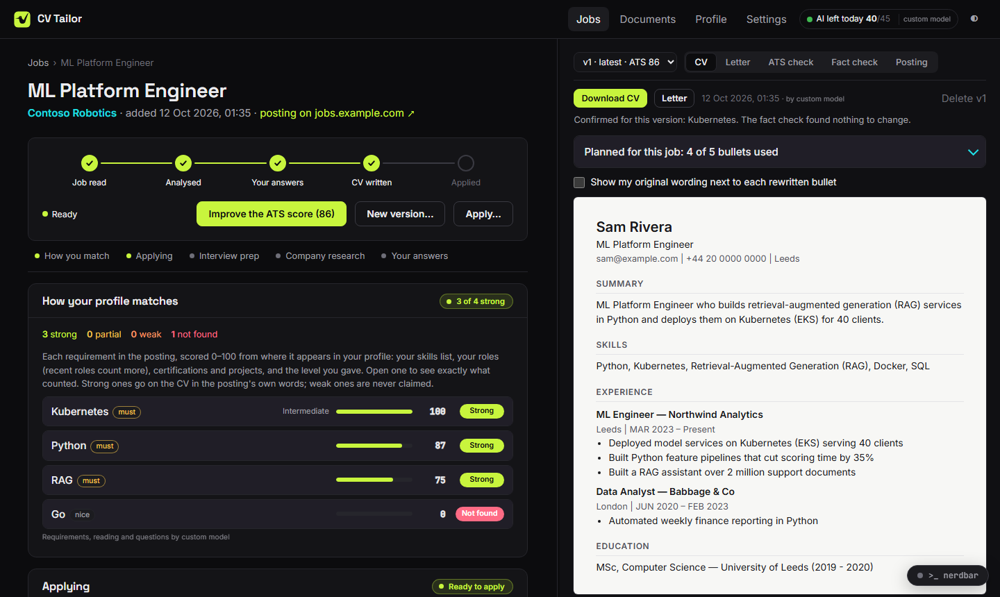
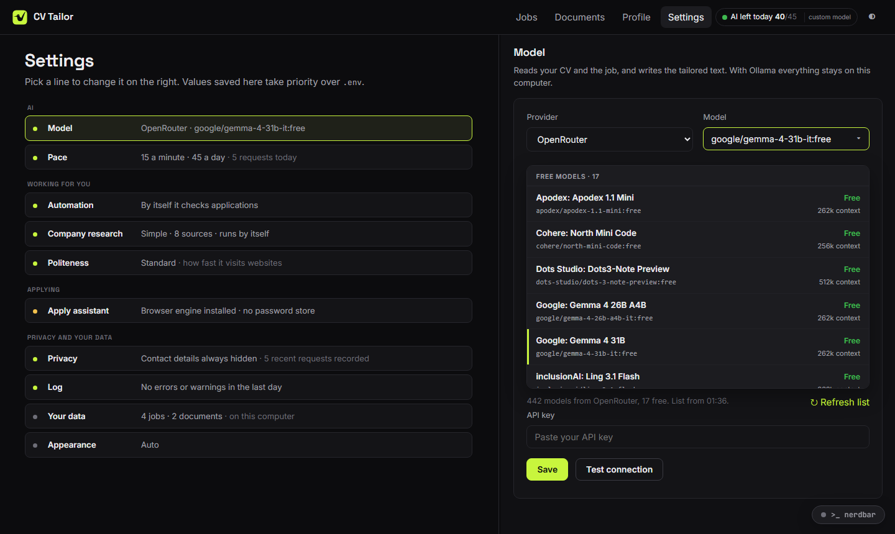

# CV Tailor

Tailor your CV and cover letter to each job, honestly, on your own computer.



## What it does

- **Reads a job** from a link (LinkedIn works) or pasted text, and compares it with your CV.
- **Asks you about the gaps** with specific questions, so nothing is claimed that you can't back up.
- **Writes a tailored CV and cover letter** (DOCX) that score well in applicant tracking systems, and shows the score and how it was counted.
- **Fact-checks everything it writes** against your profile: no invented skills, numbers or years.
- **Helps you apply:** an optional assistant fills in application forms in a browser you watch; you approve the submit.
- **Prepares you for interviews:** what to say for likely questions, and research on the company, with sources.
- **Keeps your data on your computer.** Only the AI model you choose sees your CV, with your name and contact details hidden.

| Questions about what's missing | A tailored CV, with its ATS score |
|---|---|
|  |  |

## Install

You need **Python 3.11 or newer**: get it from [python.org/downloads](https://www.python.org/downloads/).
On Windows, tick **"Add python.exe to PATH"** during installation.

Then [download this project](https://github.com/ajosh87/CV-Tailor/archive/refs/heads/main.zip) and unzip it (or `git clone` it).

### Windows

1. Open the project folder.
2. Double-click **`CV Tailor.bat`**.

The first time takes a minute or two: it sets everything up, asks whether to add the optional apply
assistant, then opens the app in your browser. After that, double-clicking it just starts the app.

### macOS and Linux

Open a terminal in the project folder and run:

```bash
python3 -m venv .venv
source .venv/bin/activate
pip install -e .
python -m cv_maker
```

The app opens at <http://127.0.0.1:5000>. Next time, run only the last two lines.

Optional, for the apply assistant: `pip install -e ".[apply]"` then `python -m playwright install chromium`.

## First run

1. **Settings → Model:** pick a provider and a model, paste your API key, and click **Test connection**.
2. **Profile:** add your CV (PDF or DOCX). Check what was read and fix anything it got wrong.
3. **Jobs:** paste one or more job links.
4. **Answer the questions** for each job, then download your tailored CV.



### Which AI model?

| Option | Cost | What you need |
|---|---|---|
| [OpenRouter](https://openrouter.ai) | Free models available (about 50 requests a day) | A free account and API key |
| [Groq](https://console.groq.com) | Free tier, rate-limited | A free account and API key |
| [Ollama](https://ollama.com) | Free; runs on your computer, nothing leaves it | Ollama installed and a model pulled (`ollama pull llama3.1`) |
| OpenAI, Azure OpenAI, AWS Bedrock | Paid | A key, plus `pip install -e ".[openai]"` (or `[azure]`, `[bedrock]`) |

The model list in Settings shows each provider's models, marked free or paid, with prices.

## Your data

- Everything stays in a folder on your computer (Settings → Your data shows where). Nothing is uploaded anywhere except the requests to your AI model.
- Your name, email, phone, address and links are replaced with placeholders before anything is sent, and filled back in on your computer.
- Settings → Privacy shows exactly what was sent, and lets you add more things to never send.

## If something goes wrong

- **"Python was not found":** install Python 3.11+ and tick "Add python.exe to PATH", then try again.
- **Port 5000 is busy:** run `python -m cv_maker --port 5001` (on Windows: `set CV_TAILOR_PORT=5001` before the `.bat`).
- **The AI isn't answering:** check the key in Settings and click **Test connection**; free models have daily limits (the header shows how many requests are left today).
- **Anything else:** Settings → Log shows every step and error.

## More

- **[The full guide](docs/GUIDE.md):** how matching, the ATS score, the fact check, the apply assistant, company research and privacy work in detail.
- **Tests:** `pip install -e ".[dev]"` then `pytest`.
